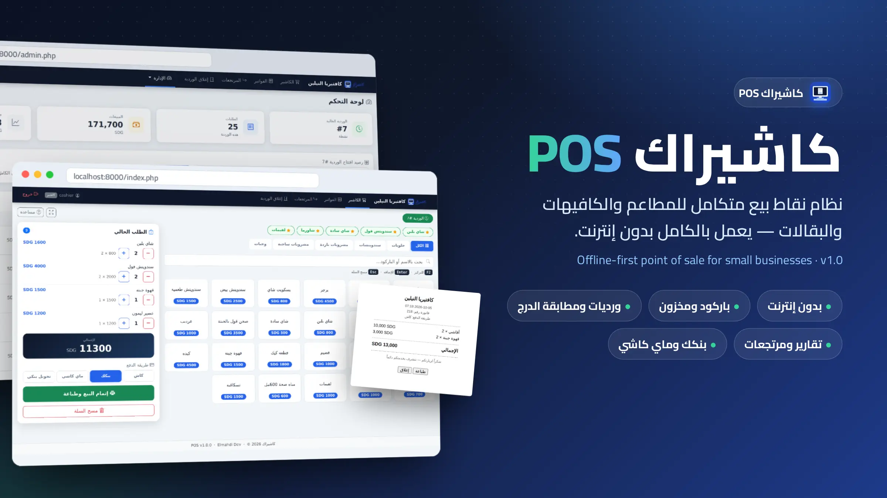

# Cashirak POS · كاشيراك

**Offline-first point of sale for restaurants, cafés, groceries and kiosks.**
Arabic-first (RTL), runs on any old Windows PC, no internet needed after activation.

**By Elmahdi Abdallh** · [Website](https://almhdy24.com) · [GitHub](https://github.com/almhdy24)

**English** · [العربية](README.ar.md) · [Website](https://almhdy24.com)

